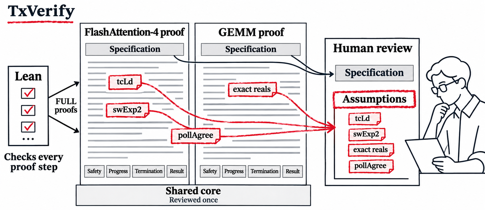
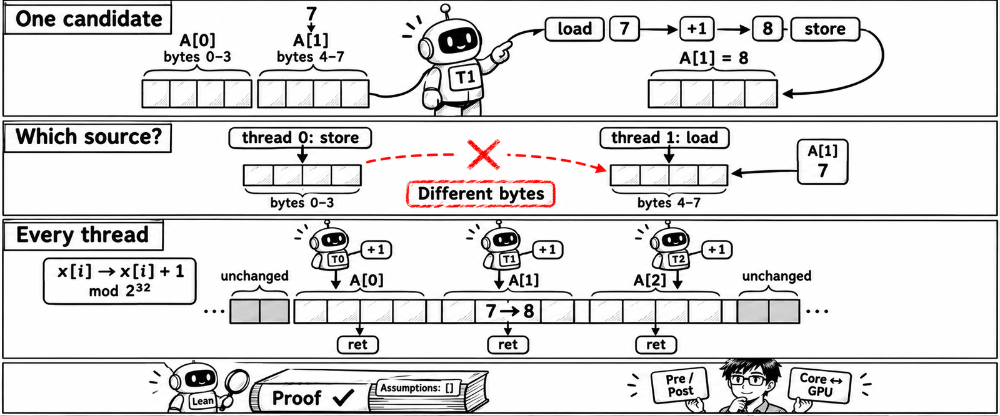

**When we say we’ve verified a GPU kernel in Lean, what exactly have we proved?**

<div class="txverify-summary" markdown="1">

## TL;DR

- In this work, we pursue two goals for verifying production GPU kernels in Lean.
  - **Coverage.** The proof should establish safety, progress, termination, and the specified result for the actual PTX, including the Blackwell features the kernel uses.
  - **Soundness.** Any error the proof rules out must be impossible on the GPU. If a load can return a value our model rules out, the proof never checks what the kernel does with that value.
- We face two challenges. First, we lack a precise formal PTX model for these Blackwell kernels. Second, even with one, assumptions about undefined behavior, numerical approximations, and *No Thin Air* would still need human review.
- Without relying on a precise core model, we can identify conditions sufficient to prove all four properties for a particular kernel. **TxVerify** is an open-source framework that **formally verifies** these four properties of production GPU kernels in **Lean**. We **split** the conditions each proof relies on between a **shared core** that records our reading of the manual and **kernel-specific assumptions** listed in each theorem. Once reviewers have checked the core, their work for each kernel **reduces to checking its specification and assumptions**.
- We proved all four properties in Lean for **13 Blackwell kernels** from compiler-emitted or hand-written PTX, including [FlashAttention-4](https://github.com/Dao-AILab/flash-attention/blob/00756db9d921da0846453283ddfbeb7457abd09b/flash_attn/cute/flash_fwd_sm100.py), [FlashMLA](https://github.com/deepseek-ai/FlashMLA/blob/395cb3afbb331fef7b1b21e9340861b9436b42d8/csrc/cuda_kernels/sm100/decode/sparse/head64/instantiations/v41_h64_no_split.cu), [TIRx FP16 GEMM](https://github.com/mlc-ai/tirx-kernels/blob/716d8a3cfc8cb5810f79f2515a39d400c1264340/tirx_kernels/gemm/fp16_bf16_gemm.py), and vLLM’s [decode (Gluon)](https://github.com/vllm-project/vllm/blob/d664cd1e96052857aea2aa844eeba571c24758b4/vllm/models/inkling2/ops/attention.py#L853) and [forward (CuTeDSL)](https://github.com/vllm-project/tml-fa4/blob/75765e76a9c2c012c1f6ecd64577eb646eb4d303/flash_attn/cute/flash_fwd_sm100.py) attention kernels for Inkling 2 Small. The proofs pinpointed **8** assumptions for FlashAttention-4 and **11** for FlashMLA, and led us to fix **2** synchronization bugs in Inkling 2 decode and **1** in the GEMM.  
- TxVerify is **open source** at [GitHub](https://github.com/mlc-ai/tx-verify). Try it, [break it](#put-it-to-the-test), or prove your own kernel with it.

</div>

<p class="fig-wide"></p>

<style>
@font-face {
  font-family: "Hanken Grotesk";
  src: url("/fonts/txverify/hanken-grotesk/latin.woff2") format("woff2");
  font-style: normal;
  font-weight: 100 900;
  font-display: swap;
}
@font-face {
  font-family: "Hanken Grotesk";
  src: url("/fonts/txverify/hanken-grotesk/latin-italic.woff2") format("woff2");
  font-style: italic;
  font-weight: 100 900;
  font-display: swap;
}
@font-face {
  font-family: "JetBrains Mono";
  src: url("/fonts/txverify/jetbrains-mono/latin.woff2") format("woff2");
  font-style: normal;
  font-weight: 100 800;
  font-display: swap;
}

:root { --txverify-sans: "Hanken Grotesk", "Helvetica Neue", Arial, sans-serif; }
body > .container > h1, .content .span14 { font-family: var(--txverify-sans); }
.content :is(h2, h3, h4, h5, h6) { font-family: inherit; }
.content :is(pre, code, samp) { font-family: "JetBrains Mono", ui-monospace, monospace; }
.content .span14.w-100 { width: 100%; max-width: min(770px, calc(100vw - 45px)); min-width: 0; margin-inline: auto; }
h1 .post-subtitle { display: block; margin-top: .35em; font-size: .65em; font-weight: 400; line-height: 1.3; }

.content a[href] {
  color: #426b70;
  text-decoration: underline;
  text-decoration-color: #9aafb1;
  text-underline-offset: .15em;
}
.content a[href]:hover, .content a[href]:focus-visible {
  color: #294f55;
  text-decoration-color: currentColor;
}

@media (min-width: 1150px) {
  body > .container > h1 { max-width: 770px; margin-inline: auto; }
}

.txverify-summary {
  box-sizing: border-box;
  margin: 1.5rem 0;
  padding: 1.1rem clamp(1rem, 3vw, 1.65rem);
  background: #f1f5f8;
  border: 1px solid #dce4ea;
  border-radius: 6px;
}
.content .txverify-summary h2 { margin-top: 0; }
.content .txverify-summary ul { margin-bottom: 0; }

.txverify-note-anchor { display: block; position: relative; }
.txverify-note { display: block; margin: .6rem 0; padding-left: .7rem; border-left: 2px solid #bcc6cc; color: #46515a; font-size: 14px; line-height: 1.45; }
@media (min-width: 1360px) {
  .txverify-note { position: absolute; left: calc(100% + 20px); bottom: 0; width: 195px; margin: 0; }
  #txverify-corpus-note { top: 0; bottom: auto; }
}

.content div.highlighter-rouge {
  position: relative;
  left: 50%;
  transform: translateX(-50%);
  width: max-content;
  max-width: min(150%, calc(100vw - 32px));
}
.content div.highlighter-rouge:not(.txverify-diagram) {
  min-width: min(100%, calc(100vw - 32px));
}
.content div.highlighter-rouge pre {
  overflow-x: auto;
}
.txverify-ptx .ptx-op { color: #174ea6; }
.txverify-ptx .ptx-reg { color: #793b86; }
.txverify-ptx .ptx-num { color: #914400; }
.txverify-ptx .ptx-label { color: #005f59; }
.txverify-ptx .ptx-comment { color: #536353; font-style: italic; }

.content h4.txverify-subheading { font-size: 18px; font-weight: 600; }
.fig-wide { margin: 1.5rem 0; }
.content img[src^="/img/txverify/"] { display: block; width: 100%; max-width: 100%; height: auto; margin-inline: auto; }
</style>

## The Renaissance of Verification

> *Many years later, as Lean finished checking a 69,552-line proof of a GEMM kernel, one of us was to remember that distant afternoon in an operating systems class when the lecturer explained that seL4, 8,700 lines of C, had taken about twenty-five person-years to build and verify.*  
>   
> — with apologies to Gabriel García Márquez, *One Hundred Years of Solitude*.<sup><a href="#txverify-sel4-note" aria-label="Read note 1">1</a></sup><span class="txverify-note-anchor"><span id="txverify-sel4-note" class="txverify-note" role="note"><sup>1</sup> Of the original kernel’s 8,700 lines of C, 7,500 were verified. The 25 person-years include design, documentation, implementation and verification. <a href="https://trustworthy.systems/projects/OLD/l4.verified/numbers">seL4 project figures</a></span></span>  

![][image2]

Those twenty-five person-years still set the standard for what a verified system means. Most code has never received this kind of effort, because proving a program correct took an expert far longer than writing it. Two changes are now bringing about a **renaissance of verification**:

- Agents now write GPU kernels faster than anyone can review them, so we need a check that does not depend on a careful human reader.  
- Agents can also write proofs. Lean checks every step, so nobody has to trust whoever wrote the proof.

GPU kernels are a good place to start, because their worst bugs are hard to see. In a warp-specialized Blackwell kernel, a copy engine, the Tensor Core, and several groups of warps hand data to each other, and a single misplaced barrier or wait breaks a hand-off. Such bugs get past careful people even in widely used code. In 2026, synchronization fixes landed in [DeepGEMM](https://github.com/deepseek-ai/DeepGEMM/pull/343), [CUTLASS](https://github.com/NVIDIA/cutlass/pull/3600), [FlashInfer](https://github.com/flashinfer-ai/flashinfer/pull/9146) and [FlashMLA](https://github.com/deepseek-ai/FlashMLA/pull/241). A synchronization error can also leave a program with **undefined behaviour** even when every test returns the expected answer. Examples appear in [FlashAttention-4](https://github.com/Dao-AILab/flash-attention/pull/3008), [CUTLASS](https://github.com/NVIDIA/cutlass/pull/3652) and [FlashInfer](https://github.com/flashinfer-ai/flashinfer/pull/6740).

Agents can write the proof, and Lean can check it. What remains for a person is to decide what the proof may rest on. This post is about keeping that part small and explicit.

## Verification ABC



If you’re new to formal verification, what does it mean to prove a GPU kernel correct? Let’s follow one word through `add_one`. If this is familiar territory, feel free to [skip ahead](#what-we-talk-about-when-we-talk-about-correctness) :)

The full kernel has nine instructions. It launches one block of threads. Thread `i` should add one to the 32-bit word `A[i]`. Here are the five instructions that compute the address and update the word. At the start of this excerpt, `%rd2` holds the array’s base address and `%r1` holds the thread index.

<div class="highlighter-rouge txverify-ptx"><div class="highlight"><pre class="highlight"><code class="language-ptx"><span class="ptx-op">mul.wide.u32</span>  <span class="ptx-reg">%rd3</span>, <span class="ptx-reg">%r1</span>, <span class="ptx-num">4</span>;
<span class="ptx-op">add.s64</span>       <span class="ptx-reg">%rd2</span>, <span class="ptx-reg">%rd2</span>, <span class="ptx-reg">%rd3</span>;
<span class="ptx-op">ld.global.u32</span> <span class="ptx-reg">%r2</span>, [<span class="ptx-reg">%rd2</span>];
<span class="ptx-op">add.s32</span>       <span class="ptx-reg">%r3</span>, <span class="ptx-reg">%r2</span>, <span class="ptx-num">1</span>;
<span class="ptx-op">st.global.u32</span> [<span class="ptx-reg">%rd2</span>], <span class="ptx-reg">%r3</span>;
</code></pre></div></div>

**Theorem (add one).** Suppose we launch one valid block of `N` threads, where `N ≤ 2³²`. The kernel parameter points to a four-byte-aligned array at address `base`, with `base + 4N < 2⁶⁴`. For each `i < N`, let `x[i]` be the 32-bit word at `A[i]` before launch. Then the kernel runs safely, can make progress whenever unfinished, and terminates under fair scheduling. In every completed execution, `A[i] = x[i] + 1` modulo 2³² for every `i < N`, and every byte outside the array retains its initial value.

**Proof.** Fix a launch and an initial array satisfying the precondition. To prove the claim about this kernel, we need to answer three questions.

**1. What does an execution record?** A candidate execution describes what each thread does in program order and where each load gets its value. For this kernel, we ask three questions about its memory effects.

- Which four bytes does each thread load, and which four does it store?
- For each byte it loads, does it read the initial value or a value supplied by a particular store?
- What value does the thread write back?

For example, if `A[1]` starts at 7, we can describe a run in which thread 1 loads those four initial bytes and stores 8 back to the same address. So far we have described one candidate.

**2. Which candidates are allowed?** The semantics gives us rules for what each instruction does and how threads can interact through memory. An execution is allowed if it satisfies those rules. Here the address instructions give thread `i` the address `base + 4*i` for both its load and its store. A store can supply a byte to a load only if it wrote to that byte’s address. Thread 0 writes bytes 0–3 and thread 1 reads bytes 4–7, so a candidate in which thread 1 reads from thread 0’s store is ruled out.<span class="txverify-note-anchor"><span class="txverify-note" role="note">For a <a href="https://x.com/ezyang/status/2123604250370445803">video walkthrough</a>, Edward Z. Yang works through what it takes to formalize a simple in-place kernel under PTX’s weak memory model.</span></span>

**3. Why does every allowed execution satisfy the theorem?** Pick any such execution and any thread `i`. Its four bytes form an aligned, initialized word, and the address bound prevents wraparound. Every other thread accesses a disjoint word, so there is no race. The thread’s own store follows its load and cannot supply it either. The load must therefore read the initial word `x[i]`. The add produces `x[i] + 1` modulo 2³², and the store writes it back. This holds for every thread. At completion every word has the specified value, and no store has touched any byte outside the array.

That proves the claim about memory *at completion*. What lets us say the kernel gets there safely? For that, the theorem also needs precise definitions of *safety*, *progress*, and *termination*. We give those in [the next section](#the-four-promises-of-a-theorem). Here the address argument already shows why the accesses are safe. An unfinished thread can always take its next step: its operands are ready, its memory accesses are valid, and it never waits for a peer. Each step moves it one instruction closer to `ret`. There are only nine instructions per thread and finitely many threads, so the kernel makes progress and every fair run finishes. ∎

**What does Lean check, and what do we check?** We write the execution rules, the theorem, and the argument in a form Lean can check. Lean verifies each step from the rules to the conclusion. That leaves two questions for the reviewer.

First, *did we state the theorem we meant to prove?* For `add_one`, we check which launches and inputs the theorem covers, what it promises during execution, and what it says about memory at completion.<span class="txverify-note-anchor"><span class="txverify-note" role="note">In the illustration, <code>Pre</code> and <code>Post</code> stand for the precondition and postcondition. <code>[]</code> is the empty list of extra assumptions for this kernel.</span></span>

Second, *do the rules that define possible executions describe the GPU faithfully enough for this theorem?* For the result claim, the rules must account for every outcome the code produced by `ptxas` can give on hardware. For the termination claim, a reviewer must also judge whether the scheduling and asynchronous progress assumptions hold on the device.

## Coverage: What We Talk About When We Talk About Correctness
{: #what-we-talk-about-when-we-talk-about-correctness}

![The theorem covers safety, progress, termination, and the specified result.][image3]

We wanted a tool for kernels that ship today. That gave us four requirements.

- **Every property in one theorem.** Many verifiers prove one property, most often the absence of data races, or prove the answer while assuming the synchronization is right. We want **safety, no deadlock, termination, and the right answer** together.  
- **No rewriting.** We prove the PTX that comes out of the compiler. A cleaned-up version would be a different program, and possibly a slower one.  
- **Every input and launch satisfying the precondition is covered.** For FlashAttention-4, the batch size, head count, and sequence lengths are symbolic. For the GEMM compiled for 8192³, the theorem covers every input and buffer placement allowed by its precondition.  
- **Every feature a production kernel uses,** including TMA, mbarriers, Tensor Memory, and Blackwell tensor cores.

### The four promises of a theorem

Each promise holds for every valid launch of the kernel and every input that meets its precondition.

- **Safety.** No execution does anything the model treats as an error: an invalid or uninitialized operand, a misaligned or unallocated access, a data race, inconsistent barrier use, divergence where lanes must agree, misuse of TMA, MMA or Tensor Memory, or a CTA exiting while its shared memory is still in use.  
- **Progress.** Every execution that cannot be extended by a counted event is complete. Every thread has either exited or belongs to a canceled cluster, and all outstanding asynchronous work and paired Tensor Memory requests have drained.  
- **Termination.** One bound limits the counted events of each launch; failed polls do not count. With progress, every fair run finishes.<sup><a href="#txverify-loop-note" aria-label="Read note 2">2</a></sup><span class="txverify-note-anchor"><span id="txverify-loop-note" class="txverify-note" role="note"><sup>2</sup> Consider <code>while (true) { a = a + 1; }</code>. Each iteration adds counted events. For any proposed bound, the loop can run one iteration further, so it cannot satisfy the termination theorem.</span></span>  
- **Result.** At completion, memory satisfies the postcondition. For floating-point kernels, the theorem names the operations it reads as exact; how far hardware results differ from exact ones is a separate question.

## Soundness: The Unbearable Weight of Proof
{: #the-unbearable-weight-of-proof}

In trying to prove safety, progress, termination, and the specified result for production GPU kernels, we ran into two difficulties.

- **We lack a precise formal model of PTX covering the Blackwell features these kernels use.** A proof needs to know which executions PTX permits when those features interact. The manual sometimes leaves room for more than one reading.
- **Even with such a model, some conditions would still need human review.** A kernel may rely on hardware behaviour that PTX leaves undefined, or use a numerical approximation whose acceptable error depends on the application. When a principle such as *No Thin Air* is difficult to formalize, a reviewer must also judge the specific assumption the proof makes in its place.

### Case 1: One Manual, Two Readings

> *There are only two kinds of languages: the ones people complain about and the ones nobody uses.*  
>   
> — Bjarne Stroustrup, creator of C++

![The PTX example places a fence between a relaxed wait and a Tensor Memory load. The alternative hand-off uses an acquire wait followed directly by the load.][image4]

The GPU does not run PTX. The ptxas compiles it to SASS, so the manual is the description of PTX that a verifier can read. On some questions, the manual gives no clear answer, and teams that write kernels answer them differently. Here are two examples.

**Lane numbers in Tensor Memory addresses.** For `tcgen05.ld` and `tcgen05.st`, a warp can access its own 32-lane partition. The question is how a load or store encodes that partition in its address. CUTLASS's [debug assertion checks that the address selects the issuing warp's partition](https://github.com/NVIDIA/cutlass/blob/b2f249acd20392beeb16f5e5a31f4f1a4e38b3bd/include/cute/atom/copy_traits_sm100.hpp#L399-L403). The verified TIRx GEMM uses a lane field of 0 for its epilogue loads.

**Reading an MMA result after an mbarrier wait.** The manual's example for this hand-off (§9.7.18.6.4.4), slightly simplified, is:

<div class="highlighter-rouge txverify-ptx"><div class="highlight"><pre class="highlight"><code class="language-ptx"><span class="ptx-comment">// thread 0                                    // thread 1</span>
<span class="ptx-op">tcgen05.mma</span> ...;
<span class="ptx-op">tcgen05.commit.mbarrier::arrive::one</span> [mbar];
                                               <span class="ptx-op">mbarrier.try_wait.relaxed.cluster</span> [mbar];  <span class="ptx-comment">// loop until success</span>
                                               <span class="ptx-op">tcgen05.fence::after_thread_sync</span>;
                                               <span class="ptx-op">tcgen05.ld</span> ...;
</code></pre></div></div>

The fence orders the load after the wait: a `tcgen05` operation after `tcgen05.fence::after_thread_sync` "is ordered after all the prior tcgen05 and the execution ordering operations", and mbarrier instructions are execution ordering operations. DeepGEMM [writes the fence](https://github.com/deepseek-ai/DeepGEMM/blob/5081f8513af57e61696de4f4f04b0e707ffb503e/deep_gemm/include/deep_gemm/impls/sm100_bf16_gemm.cuh#L368-L373). CUTLASS's C++ kernels and the TIRx Blackwell FP16 GEMM [issue `tcgen05.ld` right after an acquiring wait](https://github.com/NVIDIA/cutlass/blob/b2f249acd20392beeb16f5e5a31f4f1a4e38b3bd/include/cutlass/epilogue/collective/sm100_epilogue_tma_warpspecialized.hpp#L864-L883) and leave the fence out. The manual says the usual "synchronization mechanisms also apply to the tcgen05 family of instructions", but never says that an acquiring wait can replace the fence. This problem can largely be solved with a formal core that specifies the PTX semantics, which TxVerify can also leverage as the core.

### Case 2: One Execution Too Few, One Too Many

> *That is not only not right; it is not even wrong.*  
>   
> — attributed to Wolfgang Pauli

It may sound self-contradictory to ask whether a verification is sound, but in many cases we found ourselves producing a “not even wrong” proof when we were not careful. 

Even where [Chapter 8 of the manual](https://docs.nvidia.com/cuda/parallel-thread-execution/#memory-consistency-model) gives explicit rules for memory consistency, what counts as a safe reading depends on the property: missing a hardware execution breaks the result proof (2.1), while adding one can hide a deadlock (2.2).

#### 2.1 What can SC \+ happens-before miss?
{: .txverify-subheading}

![Six SC interleavings yield three possible outcomes for (rA, rB): (0, 0), (0, 1), and (1, 0). In every interleaving, the first load reads 0.][image5]

If our model excludes an outcome the hardware can produce, our proof covers too few cases. Proving the result correct for every execution in the model then gives us no guarantee about the execution we left out. The PTX load-buffering test shows how this can happen.

A conventional way to reason about how threads share memory is to assume sequential consistency (SC). Under SC, all memory operations appear in one global order that respects each thread’s program order, and each load reads the latest store to its address in that order.

Both threads run on the same GPU. The global symbols <code>x</code> and <code>y</code> name distinct aligned 32-bit words, both initially zero. PTX classifies each conflicting pair as morally strong and race-free.<sup><a href="#txverify-scope-note" aria-label="Read note 3">3</a></sup><span class="txverify-note-anchor"><span id="txverify-scope-note" class="txverify-note" role="note"><sup>3</sup> For <code>x</code>, both threads access the same four bytes through the same proxy. Both instructions use GPU scope, which covers both threads. The same holds for <code>y</code>. <a href="https://docs.nvidia.com/cuda/parallel-thread-execution/#morally-strong-operations">PTX §8.7</a></span></span>

<div class="highlighter-rouge txverify-ptx"><div class="highlight"><pre class="highlight"><code class="language-ptx"><span class="ptx-comment">// thread A                                // thread B</span>
<span class="ptx-op">ld.relaxed.gpu.global.u32</span> <span class="ptx-reg">%rA</span>, [x];         <span class="ptx-op">ld.relaxed.gpu.global.u32</span> <span class="ptx-reg">%rB</span>, [y];
<span class="ptx-op">st.relaxed.gpu.global.u32</span> [y], <span class="ptx-num">1</span>;           <span class="ptx-op">st.relaxed.gpu.global.u32</span> [x], <span class="ptx-num">1</span>;
</code></pre></div></div>

Can both loads return 1? The table lists every interleaving that preserves each thread’s program order, with each load reading the latest value on that timeline.

Under SC, `(1, 1)` is impossible. In every interleaving, the first operation is a load and it reads 0\.

But PTX allows `(1, 1)`. The manual lists this test and says: "This form of load buffering is deliberately permitted in the PTX memory consistency model." [PTX §8.10.4](https://docs.nvidia.com/cuda/parallel-thread-execution/#no-thin-air-axiom) The manual's version uses plain accesses. With relaxed accesses, no axiom forbids `(1, 1)` either.

Our race checker in [TIRx Harness](https://github.com/mlc-ai/TIRx-harness/blob/main/skills/tirx-debug-kernel/references/racecheck.md#L44) uses vector clocks to track which accesses are ordered. Even a perfect vector clock on each of those six timelines would miss `(1, 1)`. None of the six produces it.

Why? PTX distinguishes *program order* from *reads-from* (rf). Program order puts each thread’s load before its own store. An rf edge connects a store to the load that reads its value. Here A can read B’s store to `x`, and B can read A’s store to `y`. Both stores write 1 unconditionally.

You may wonder why we allow this at all. Thread A reads `x`, thread B writes it, and nothing orders the two. Isn’t that a data race? [Under PTX’s rules](https://docs.nvidia.com/cuda/parallel-thread-execution/#conflict-and-data-races), this pair is race-free because the accesses are morally strong. The same goes for `y`. So a program can be race-free under PTX and still produce `(1, 1)`, which SC misses.

Suppose we rule out such programs anyway and require happens-before to order every conflicting pair before treating the program as sequential. This raises two problems.

1. **We exclude legal PTX programs.** This restriction would reject the load-buffering example above and other programs that deliberately use relaxed accesses without ordering every conflict.
2. **It is still not sound.** To show that a program meets this stronger requirement, we must prove that happens-before orders the conflicting accesses of every execution. But happens-before depends on the values loads return: a loaded value can pick a branch, an address, or whether a thread arrives on a barrier.  
   So, in practice, the order depends on the values loads are expected to return, such as the launch inputs. The axioms also admit executions where a load returns a value written by a racing store that exists only because of that value.  
   Such an execution has different addresses, branches, and order, and its race is never examined. The ordering rules alone admit these executions. PTX addresses them with its No Thin Air axiom, and no accepted precise version of it exists for PTX, C++, or Java<sup><a href="#txverify-oota-note" aria-label="Read note 4">4</a></sup> (see Case 5).<span class="txverify-note-anchor"><span id="txverify-oota-note" class="txverify-note" role="note"><sup>4</sup> The C++ draft gives the same two-thread example: both words start at zero, and each thread copies what it reads. It recommends ruling out a value that could only have come from the other thread copying it. Java gives a formal causality test that commits actions in stages. <a href="https://eel.is/c++draft/atomics.order#8">C++ draft §[atomics.order]</a> · <a href="https://docs.oracle.com/javase/specs/jls/se25/html/jls-17.html#jls-17.4.8">Java §17.4.8</a></span></span>

#### 2.2 Can allowing too many executions hide a deadlock?
{: .txverify-subheading}

![If B reads 0, A waits forever. The core also admits a separate execution in which B reads 1 and signals A.][image6]

Suppose we allow more executions than the hardware can produce. For safety and the result, every extra execution is one more case the proof must cover. A single unsafe execution or wrong result still makes the proof fail.

For progress, however, suppose a kernel has deadlocked on the hardware, but our model still allows a step that would unblock it. We would wrongly conclude that the kernel can keep running when it is already stuck.

Consider a word `x` initially equal to 0 and a barrier `M` that expects one arrival. A waits before storing 1\. B arrives only if it reads 1\.

<div class="highlighter-rouge txverify-ptx"><div class="highlight"><pre class="highlight"><code class="language-ptx"><span class="ptx-comment">// thread A</span>
<span class="ptx-label">wait:</span>
<span class="ptx-op">mbarrier.try_wait.parity.relaxed.cta.shared::cta.b64</span>  <span class="ptx-reg">%p0</span>, [M], <span class="ptx-num">0</span>;
@!<span class="ptx-reg">%p0</span> <span class="ptx-op">bra</span> wait;
<span class="ptx-op">st.relaxed.sys.global.u32</span>  [x], <span class="ptx-num">1</span>;
<span class="ptx-op">exit</span>;

<span class="ptx-comment">// thread B</span>
<span class="ptx-op">ld.relaxed.sys.global.u32</span>  <span class="ptx-reg">%r1</span>, [x];
<span class="ptx-op">setp.eq.u32</span>  <span class="ptx-reg">%p1</span>, <span class="ptx-reg">%r1</span>, <span class="ptx-num">1</span>;
@<span class="ptx-reg">%p1</span> <span class="ptx-op">mbarrier.arrive.relaxed.cta.shared::cta.b64</span>  <span class="ptx-reg">%rd1</span>, [M];
<span class="ptx-op">exit</span>;
</code></pre></div></div>

B reads 0, skips the arrival, and exits. A is now waiting for Godot. It can keep polling, but the only thread that could signal the barrier has gone home. Failed polls add no counted event, so this execution is stuck.

The core also admits a completed execution: B reads 1 from A’s store and signals the barrier, which lets A reach the very store that supplied the 1\. (For why the core admits this execution, see [No Thin Air in Case 5](#case-5-the-no-thin-air-curse).)

<p>Let <math><msub><mi>e</mi><mtext>deadlock</mtext></msub></math> be the execution where B reads 0 and exits, and <math><msub><mi>e</mi><mtext>complete</mtext></msub></math> the circular execution where B reads 1 and A finishes. The set of executions the core admits contains both:</p>

<div><math display="block"><mrow><mo>{</mo><msub><mi>e</mi><mtext>deadlock</mtext></msub><mo>}</mo><mo>∪</mo><mo>{</mo><msub><mi>e</mi><mtext>complete</mtext></msub><mo>}</mo><mo>⊆</mo><msub><mtext>Executions</mtext><mtext>core</mtext></msub><mo>.</mo></mrow></math></div>

Only the deadlock can happen on hardware: B signals only after reading 1, and A supplies that 1 only after B signals. Progress must hold for every admitted execution, and once B has read 0 and exited, no extension changes its read, so the deadlock still fails the progress check. 

Extra executions would hide a deadlock only if the core admitted a continuation of every deadlocked execution. **We have found no such kernel pattern,** **but we also have no proof that none exists**.

That is why, on balance, we **prefer to keep the extra possibilities** when the manual leaves a behaviour open. Excluding a possible hardware outcome can already give a wrong answer, as the load-buffering example shows. In the progress examples we have been able to construct, the real deadlock still causes the proof to fail.

### Case 3: Kernels on Thin Ice

> *something for nothing*  
>   
> — cheat code in StarCraft (1998)  

![FlashMLA uses the two halves of Tensor Memory for a dual GEMM. Layout E shows how the result is distributed.][image7]

Some kernels go beyond the vague parts of the manual and do things it leaves undefined, by accident or on purpose.

**FlashAttention-4.** Its correction warps read the accumulator O from Tensor Memory with `tcgen05.ld`, use the values, and then [arrive on an mbarrier](https://github.com/Dao-AILab/flash-attention/blob/bd26bc8e10e7c8f10dce6e17276156accecd2994/flash_attn/cute/flash_fwd_sm100.py#L3239-L3245) so that the MMA warp can accumulate into O again. They never execute `tcgen05.wait::ld`. PTX respects a true register dependency on the load. That dependency alone gives no memory ordering between the load and a later overwrite of its Tensor Memory cells (§9.7.18.6.4.5). The MMA's write to O is unordered with the load, so the behaviour is undefined.

**FlashMLA relies on an undocumented layout.** Its 64-head sparse decode kernel uses `tcgen05.mma.ws` in the QK stage to compute two partial products at once. The [QK configuration](https://github.com/deepseek-ai/FlashMLA/blob/395cb3afbb331fef7b1b21e9340861b9436b42d8/csrc/cuda_kernels/sm100/decode/sparse/head64/config.h#L173-L176) doubles the output-column count to `B_TOPK*2`. The [Layout E figures](https://docs.nvidia.com/cuda/parallel-thread-execution/#tcgen05-data-path-layout-e) show how the result is distributed for M \= 64 in `.ws` mode. The extra detail FlashMLA relies on is which copy of operand A each group of output columns reads when the two halves contain different data. The [decode source](https://github.com/deepseek-ai/FlashMLA/blob/395cb3afbb331fef7b1b21e9340861b9436b42d8/csrc/cuda_kernels/sm100/decode/sparse/head64/kernel.cuh#L473-L490) shows the split across eight 64-dimensional blocks of the QK dot product. One half handles blocks 0, 2, 4, and 6, and the other handles 1, 3, 5, and 7.

**Our own GEMM has a milder case.** It stages each output tile in shared memory for a TMA store, and before reusing the buffer it waits only until the copy has read it:<sup><a href="#txverify-tma-read-note" aria-label="Read note 5">5</a></sup><span class="txverify-note-anchor"><span id="txverify-tma-read-note" class="txverify-note" role="note"><sup>5</sup> A TMA store reads a shared-memory tile and writes it to global memory. Its source read can finish while the destination write is still pending. The <code>.read</code> wait distinguishes those two moments.</span></span>

<div class="highlighter-rouge txverify-ptx"><div class="highlight"><pre class="highlight"><code class="language-ptx"><span class="ptx-op">cp.async.bulk.wait_group.read</span> <span class="ptx-num">1</span>;     <span class="ptx-comment">// all but the newest bulk group must have finished reading</span>
<span class="ptx-op">bar.sync</span> <span class="ptx-reg">%r389</span>, <span class="ptx-num">128</span>;
<span class="ptx-op">st.shared.v4.u32</span> [<span class="ptx-reg">%r527</span>], {...};     <span class="ptx-comment">// overwrite the buffer</span>
</code></pre></div></div>

TMA reads shared memory through a different *proxy* from ordinary stores. The manual orders the two after the copy has *completed*, because completion includes an implicit fence between the proxies, or after an explicit proxy fence. The `.read` wait gives neither. CUTLASS [reuses its buffers the same way](https://github.com/NVIDIA/cutlass/blob/b2f249acd20392beeb16f5e5a31f4f1a4e38b3bd/include/cutlass/pipeline/sm90_pipeline.hpp#L714-L719), and the pattern almost certainly works.

### Case 4: The Almost-Exponential

> *This art of epsilon management, once mastered, is not terribly difficult.*  
>   
> — Terence Tao, *Ultrafilters, nonstandard analysis, and epsilon management* (2007)

![The software exponential splits the input into integer and fractional parts and uses three fused multiply-adds to approximate the exponential of the fractional part.][image8]

FlashAttention-4's softmax uses the FMA units to compute 2^x for a configurable fraction of its exponentials:

1. **Split.** A round-down addition of 1.5·2²³ splits x into an integer n and a fraction f in \[0, 1).<sup><a href="#txverify-round-down-note" aria-label="Read note 6">6</a></sup><span class="txverify-note-anchor"><span id="txverify-round-down-note" class="txverify-note" role="note"><sup>6</sup> Try <code>x = 3.75</code>. Near <code>C = 1.5 × 2²³</code>, adjacent FP32 numbers are one unit apart. Adding <code>x</code> to <code>C</code> and rounding down gives <code>C + 3</code>. Subtracting <code>C</code> recovers 3, leaving 0.75 for the polynomial.</span></span>  
2. **Approximate.** Three FMAs evaluate 2^f ≈ 1 \+ 0.6951 f \+ 0.2276 f² \+ 0.0771 f³.  
3. **Reassemble.** A shift by 23 and an integer addition write n into the exponent bits.

The code clamps x from below at −127, and the upper bound lives only in a comment: ["We assume x \<= 127.0"](https://github.com/Dao-AILab/flash-attention/blob/bd26bc8e10e7c8f10dce6e17276156accecd2994/flash_attn/cute/utils.py#L827-L840). Even with exact evaluation, the polynomial only approximates 2^f.

Treating each instruction as exact would erase the rounding on which the split depends.

### Case 5: The No Thin Air Curse

> *No signal travels faster than light, so if one event can influence another, it precedes the other in every inertial frame.*  
>   
> — the causality principle of special relativity  

![Two CTAs each read a value from the other CTA’s misaddressed output store and use it to compute their own store address. The dependencies form a cycle.][image9]

Compilers and hardware want as few restrictions as possible, so that they can reorder instructions, buffer stores, and keep values in caches. The PTX memory model therefore promises little, and it is written declaratively, as a set of axioms. 

It does not describe how the machine runs. It judges a whole execution at once: an execution is a set of events with relations between them, and the model checks those relations against its rules. The model records which write supplied each byte of a load. Its axioms constrain those choices across the execution.

The manual's own example shows what this allows ([§8.10.4](https://docs.nvidia.com/cuda/parallel-thread-execution/#no-thin-air-axiom)). This version of the load-buffering test uses plain loads and stores, and each thread writes the value it just read. Both words still start at 0:

<div class="highlighter-rouge txverify-ptx"><div class="highlight"><pre class="highlight"><code class="language-ptx"><span class="ptx-comment">// thread 1                          // thread 2</span>
<span class="ptx-op">ld.global.u32</span>  <span class="ptx-reg">%r0</span>, [x];             <span class="ptx-op">ld.global.u32</span>  <span class="ptx-reg">%r1</span>, [y];
<span class="ptx-op">st.global.u32</span>  [y], <span class="ptx-reg">%r0</span>;             <span class="ptx-op">st.global.u32</span>  [x], <span class="ptx-reg">%r1</span>;
</code></pre></div></div>

Suppose both loads return 42\. The table traces where each event gets its value, starting at thread 1’s load.

<style>
table.event-sources { width: 100%; table-layout: fixed; border-collapse: collapse; }
table.event-sources th, table.event-sources td { box-sizing: border-box; border: 1px solid #c9ced4; text-align: left; vertical-align: middle; }
table.event-sources th:first-child { width: 36%; }
table.event-sources th:nth-child(2), table.event-sources td:nth-child(2) { width: 15%; text-align: center; font-variant-numeric: tabular-nums; }
</style>

| Event | Value | Where does the value come from? |
| :---- | :---: | :---- |
| A. Thread 1 loads `x` | 42 | It reads the value stored by D. |
| D. Thread 2 stores to `x` | 42 | It copies the register set by C. |
| C. Thread 2 loads `y` | 42 | It reads the value stored by B. |
| B. Thread 1 stores to `y` | 42 | It copies the register set by A. |
{: .event-sources}

Both threads have the answer. Neither can say where it came from. Follow the reads and writes from A to D to C to B, and we end up back at A. Each store copies its register correctly, and neither load reads from a store ordered after it. The ordering rules alone therefore admit this candidate, even though the only source for 42 is the cycle itself.

The manual forbids this with its <u>No Thin Air axiom: "an execution cannot speculatively produce a value in such a way that the speculation becomes self-satisfying through chains of instruction dependencies and inter-thread communication."</u> 

It does not define which dependencies count, and it lets the implementation "perform any chain of reasoning to determine that a store is not dependent on a prior load". NVIDIA's [CUDA Tile IR memory model](https://docs.nvidia.com/cuda/tile-ir/13.1/sections/memory_model.html), which is derived from the PTX memory model, says: "It is not practical to specify a “no thin air” axiom without preventing useful compiler optimizations."<sup><a href="#txverify-java-cse-note" aria-label="Read note 7">7</a></sup><span class="txverify-note-anchor"><span id="txverify-java-cse-note" class="txverify-note" role="note"><sup>7</sup> Java’s memory model gives a formal causality test. Ševčík and Aspinall showed that common subexpression elimination could produce an outcome the model forbids for the original program. <a href="https://docs.oracle.com/javase/specs/jls/se25/html/jls-17.html#jls-17.4.8">Java §17.4.8</a> · <a href="https://www.research.ed.ac.uk/en/publications/on-validity-of-program-transformations-in-the-java-memory-model/">ECOOP 2008 paper</a></span></span>

The example looks artificial, but a production kernel runs into the same cycle. In vLLM's [Inkling 2 decode attention kernel](https://github.com/vllm-project/vllm/blob/d664cd1e96052857aea2aa844eeba571c24758b4/vllm/models/inkling2/ops/attention.py#L844-L1100), each CTA loads the start of its request from an input array and uses it to compute where its output goes:

```py
q_start = gl.load(CuSeqlensQ + req)                   # load an input
...
out = (split * num_tokens + q_start + tok) * H + head
gl.store(LsePart + out, lse, mask=row_valid)          # the store address depends on the loaded value
```

Could one CTA’s output store overwrite the `q_start` that another CTA reads? The CTAs do not synchronize, so we have to reason about where the store lands. Suppose some store touched the input array, and take the first such store in time. Every load before it returned the launch value, so every output address computed before it is correct, and the store goes to the output arrays. So no store ever touches the input array.

That argument follows the order of time, and the model cannot state it. The model admits this cycle between two CTAs A and B:

<div class="txverify-diagram highlighter-rouge"><div class="highlight"><pre class="highlight"><code>A: load q_start  ──(address)──►  A: store output
       ▲                               │
   (read by)                       (read by)
       │                               ▼
B: store output  ◄──(address)──  B: load q_start
</code></pre></div></div>

Each load returns a wrong value that the other CTA's store wrote, and each store lands on the other CTA's input because its address came from a wrong load. In the manual's example, the stored value depends on the load. Here the store address does, and the cycle is the same. The ordering rules alone admit both reads, even though the resulting stores land on input bytes. To establish that the kernel preserves its inputs, the proof must rule out that cycle.

## Insight: Two Kinds of Sufficient Conditions

> *Young man, you don't understand PTX. You just get used to it.*  
>   
> — with apologies to John von Neumann, who said this about mathematics

![Two tile hand-offs use acquire waits. One consumer reads shared memory, while the TIRx GEMM consumer reads Tensor Memory and relies on the acquire ordering that load.][image10]

So, are we doomed? 

As we worked through these cases, one simple fact stood out. Engineers have shipped production GPU kernels for years without a complete formal model of PTX. 

They reason about a kernel by identifying conditions sufficient to make each part work. At a hand-off, for instance, the author checks which barrier the producer signals and which phase the consumer waits for before reading the tile.

**Instead of only relying on a full core model, we ask: what do we need to trust to establish that a production kernel is safe, makes progress, terminates, and produces its specified result? Can we state those conditions clearly and concisely enough for a person to review them?**

Looking at the conditions engineers rely on, we found two kinds. 

**The first group covers conditions shared across kernels.** The PTX manual gives two examples.

- **TMA load.** `cp.async.bulk.tensor` signals an mbarrier when the copy is done. A thread whose acquire wait observes completion of that phase can read the tile with `ld.shared`.  
- **TMA store.** A thread writes the tile with `st.shared`, then executes `fence.proxy.async.shared::cta` and `bar.sync`. The `cp.async.bulk.tensor` store that follows reads the written values.

Where the manual leaves a behaviour open, a shared condition **keeps the extra executions** **(Case 2\)**. Missing one the hardware can produce makes the result proof unsound. Adding one could in principle hide a deadlock, and we cannot prove it never does, but we have found no kernel where every deadlocked execution has a continuation the model lets run.

**The second group covers conditions a particular kernel relies on**. Each case above raises a question that no single answer settles for every kernel. A kernel's authors do not settle it in general. They state what their kernel relies on.

- **The manual leaves a question open (Case 1).** The TIRx GEMM relies on an acquiring mbarrier wait ordering a later `tcgen05.ld` without `tcgen05.fence::after_thread_sync`. TxVerify records this assumption in the shared core as `EXT-TCACQUIRE`.   
- **The manual leaves a pattern undefined (Case 3\)**. FlashAttention-4 relies on each `tcgen05.ld` completing before its cells can be overwritten, as if a `tcgen05.wait::ld` followed it.   
- **The code computes an approximation (Case 4\)**. To prove the exact attention result, we assume that FlashAttention-4’s software exponential computes 2<sup>x</sup> exactly.   
- **Correctness needs a rule no one can state precisely (Case 5\)**. For Inkling decode, we assume that the load of `q_start` returns its launch value. Lean then proves that the store whose address depends on `q_start` writes to the output array.

## The Core/Assumption Split

> *Simplicity favors regularity*  
>   
> — David A. Patterson and John L. Hennessy, Computer Organization and Design, Design Principle 1

![FlashAttention-4 and GEMM share a core. The FlashAttention proof also uses a site-specific assumption to order a Tensor Memory load before the next MMA overwrite.][image11]

TxVerify makes this distinction explicit in each correctness proof. 

**The core (trusted, under review)** is a set of sufficient conditions that we believe hold for PTX in general. Almost every kernel shares these conditions, so the core states each of them once.

- Where the manual is clear, the core keeps the rule as written.  
- Where the manual is vague, the core takes a conservative reading. Each such reading is marked as an interpretation.

**An assumption is a condition of one kernel**. We list each such condition explicitly as an assumption of that kernel and prove the kernel on that basis. The assumptions are left for a person to review. A kernel's own condition stays out of the core.

Our claim, which the experiments below support, is that reviewing a modest number of assumptions is enough to establish a kernel's correctness statement. The FlashAttention-4 theorem lists eight assumptions, the FlashMLA theorem lists eleven, and the GEMM theorem lists three kinds.

### Core

One principle runs through the core: **no order is free**.

Two events are ordered **only when the manual or a named interpretation says so**. Within a thread, loads and stores follow program order, but every other order needs a rule, including the order of the asynchronous operations the thread issues.

The core has a layer for a single thread and three kinds of order:

- A [thread](https://github.com/mlc-ai/tx-verify/blob/94a1f589ecb9493d69dc632723823d9cfe1b6bb5/docs/core/threads.md) executes its instructions in program order, given the values its reads return.  
- Causality, the [memory model](https://github.com/mlc-ai/tx-verify/blob/94a1f589ecb9493d69dc632723823d9cfe1b6bb5/docs/core/memory.md), orders memory accesses through program order, barriers, release and acquire, and proxy fences.  
- Each [barrier](https://github.com/mlc-ai/tx-verify/blob/94a1f589ecb9493d69dc632723823d9cfe1b6bb5/docs/core/barriers.md), [mbarrier](https://github.com/mlc-ai/tx-verify/blob/94a1f589ecb9493d69dc632723823d9cfe1b6bb5/docs/core/mbarrier.md) and [Tensor Memory](https://github.com/mlc-ai/tx-verify/blob/94a1f589ecb9493d69dc632723823d9cfe1b6bb5/docs/core/tmem.md) allocator has an object order, in which its operations take effect one by one.  
- A dependency order says that a wait returns after the completion it waits for, and that an [asynchronous operation](https://github.com/mlc-ai/tx-verify/blob/94a1f589ecb9493d69dc632723823d9cfe1b6bb5/docs/core/async.md) completes after its issue.

The [correctness](https://github.com/mlc-ai/tx-verify/blob/94a1f589ecb9493d69dc632723823d9cfe1b6bb5/docs/core/correctness.md) layer combines them: it defines the possible executions, what counts as going wrong, and when an execution has finished. Together, progress and the bound on counted events imply that every fair run in the model finishes.

The core covers the TMA, mbarrier, `tcgen05` and Tensor Memory instructions, among others. An instruction form without a rule is rejected. The core leaves out `wgmma`, `wmma`, the texture, surface and video instructions, and function calls and stack allocation.

### Assumption

When a proof gets stuck on an ordering obligation, we check whether the kernel establishes the required order. If the kernel relies on an order the core does not guarantee, we state that reliance as an **assumption**. 

An assumption can give this one kernel an order or a value that the core does not give, or it can exempt a case from one of the core's safety checks. It names the instructions it covers, cites the passage of the manual or the practice it rests on, and says why the kernel needs it. The theorem lists every assumption, and at all other instructions the core applies unchanged.

The agent that writes the proof also proposes its assumptions. When the proof needs an order that the core does not give, the agent reads the kernel's PTX, its source and the comments in the source. It then either reports a bug or states the order that the authors intended, as narrowly as the proof allows, and every assumption is left for a person to review.

**One assumption of FlashAttention-4.** A production kernel also relies on conditions that the core does not contain. The FlashAttention-4 theorem lists eight assumptions, and the [evaluation](#what-assumptions-do-they-need) shows all of them. `pollAgree` shows how narrow such an assumption is. The store warp waits like this:

<div class="highlighter-rouge txverify-ptx"><div class="highlight"><pre class="highlight"><code class="language-ptx"><span class="ptx-label">LAB_WAIT:</span>
<span class="ptx-op">mbarrier.try_wait.parity.shared.b64</span> <span class="ptx-reg">P1</span>, [<span class="ptx-reg">%r635</span>], <span class="ptx-reg">%r3594</span>, <span class="ptx-num">10000000</span>;
@<span class="ptx-reg">P1</span> <span class="ptx-op">bra.uni</span> DONE;
<span class="ptx-op">bra.uni</span>     LAB_WAIT;
</code></pre></div></div>

`bra.uni` promises that all lanes executing it together have the same predicate (§9.7.14.3). Each lane runs its own `try_wait`, so two lanes can hold different results. At the 37 selected branches, the assumption exempts the lanes from the branch-uniformity check when their polls read the same mbarrier. The kernel could drop the assumption by using a plain `bra`.

### A fundamental assumption about scheduling (EXT-FAIR): What, in the end, are progress and termination?

![An execution with a pending copy extends to one with a completed copy and a successful wait. The earlier thread events and the source of the load are preserved.][image12]

You may have noticed a problem while reading Cases 2 and 5\. The PTX memory model takes an execution as input: each thread's events in program order and the write each load reads from. It then judges whether that execution is consistent. 

This brings us back to a fundamental question: **how does PTX define what it means to execute a program? Put simply, does the manual have a notion of a step, of time, or of a clock**?

The most conservative answer we can give is **no**. This raises two problems.

1. If we cannot say what an execution is or what its next step is, how do we define that a program makes progress, or that it terminates?

2. How should we understand instructions that block, such as bar.sync and an mbarrier wait, and instructions that complete asynchronously, such as a TMA copy?

We **order executions by extension**. An execution can grow while preserving what has already happened. A thread can take its next instruction, and a pending copy can complete. A load that already read 0 must still have read 0 from the same write, and a barrier keeps the arrivals it has already recorded.

With this order, the four notions are defined as follows.

1. **Progress.** Every execution that cannot grow by a counted event is complete. Every thread has either exited or belongs to a canceled cluster, and all outstanding asynchronous work and paired Tensor Memory requests have drained. A deadlock is an incomplete execution with no extension that adds a counted event.

2. **Termination.** One bound limits the counted events of every possible execution. Failed polls are not counted.

3. **Blocking instructions.** Their events can join an execution only after what they wait for: a bar.sync after the other warps arrive or exit, a successful try\_wait after its phase completes. A failed poll can always join but is not counted, so spinning is not progress.

4. **Asynchronous instructions.** A TMA copy or an MMA adds an issue event to its thread, and its reads, writes and completion as separate events that later extensions may add. An execution is complete only when every issued operation has finished.

Our assumption **EXT-FAIR** bridges this model of extensions with hardware. We believe that whenever an execution can grow by a counted event, such as a copy completing or a poll succeeding, the hardware eventually adds one. This belief comes from the forward-progress guarantees of the CUDA programming guide. To carry the termination result over to hardware, we must also trust that whenever the model admits a counted step from an unfinished hardware execution, the hardware can actually make progress. [Section 2.2](#22-can-allowing-too-many-executions-hide-a-deadlock) explains why this matters. Safety holds independently of fairness.

### What must a reviewer read?

Lean checks that each proof derives its theorem from the **trusted base**: the core, the kernel's specification and the assumptions its theorem lists. A reviewer reads only these.

- **The core** (trusted, under review) is about 47,000 lines of Lean, about 14,000 of them generated from a table of PTX instruction syntax. It holds the rules and the 61 interpretations, each next to the passage of the manual it rests on. It is shared by every kernel.  
- **The specification and assumptions** (trusted, for a person to review) say what the kernel must compute and what it relies on beyond the core. For FlashAttention-4, `Spec.lean` and `Assumptions.lean` have 235 and 198 lines, and the software `exp2` assumption reads an 89-line template.  
- **The shared library** (checked by Lean), about 152,000 lines, holds lemmas proved from the core, such as facts about rings of mbarriers.  
- **The proof of each kernel** (checked by Lean). Separate checks confirm that the proofs use only Lean's three standard axioms, and that the theorem *statements* refer only to the core, the kernel's assumptions, its specification, its PTX, and the libraries they use.<sup><a href="#txverify-axioms-note" aria-label="Read note 8">8</a></sup><span class="txverify-note-anchor"><span id="txverify-axioms-note" class="txverify-note" role="note"><sup>8</sup> Lean reports three foundational axioms here. Where do FlashAttention-4’s eight assumptions appear? In the theorem statement itself, which says exactly what follows when those assumptions hold.</span></span>

## Evaluation

### Can production kernels be proved on this core/assumption split?

All thirteen kernels target Blackwell (`sm_100a`). The first four rows are prototype kernels. They are small, hand-written or compiled from a few lines of CUDA, and each exercises one part of the core. The last six rows are production kernels, and their proofs take the frozen compiler output as input.

| Kernel | PTX instructions | What it exercises | Assumptions in the theorem | Proof (lines) |
| :---- | ----: | :---- | :---- | ----: |
| Add one (hand-written) | 9 | one load, one add, one store per thread | none | 1,071 |
| Two copies, row sum, block sum | 16–31 | loads and stores, a loop, a CTA barrier | one copy: read-only `ld.global.nc` at one site; other copy: none; sums: exact `add.f32` | 1,054–2,821 each |
| TMA copy | 18 | asynchronous copy completing on an mbarrier | none | 2,545 |
| Tensor Core GEMM (int8) | 60 | Tensor Memory, one `tcgen05` MMA | none | 9,339 |
| [TIRx RMSNorm](https://github.com/mlc-ai/tirx-kernels/blob/7ab6f5252dcb27563680c3d140169e4cef6e49b3/tirx_kernels/norm/rmsnorm.py) | 295 | persistent loop, warp shuffles, approximate math | exact reals for its listed forms; approximate division and reciprocal square root read as exact | 11,557 |
| [TIRx Blackwell FP16 GEMM](https://github.com/mlc-ai/tirx-kernels/blob/716d8a3cfc8cb5810f79f2515a39d400c1264340/tirx_kernels/gemm/fp16_bf16_gemm.py) | 1,097 | 2-CTA MMA, four-stage TMA ring, run-time tile scheduling, TMA stores | exact reals for its listed forms; cluster-scope mbarrier at its 37 sites; branch-uniformity exemption at two poll branches | 69,552 |
| [FlashMLA](https://github.com/deepseek-ai/FlashMLA/blob/395cb3afbb331fef7b1b21e9340861b9436b42d8/csrc/cuda_kernels/sm100/decode/sparse/head64/instantiations/v41_h64_no_split.cu) sparse decode, head64 | 3,612 | six warp roles, a paged e4m3 KV cache dequantized with ue8m0 scales, a top-k sparse index gather, `tcgen05.mma.ws` | 11, including exact reals, approximate `ex2`, `div` and `lg2`, read-only `ld.global.nc` loads, pointer arithmetic, and the order and lifetime of its last commits and output stores | 137,315 |
| [FlashAttention-4](https://github.com/Dao-AILab/flash-attention/blob/00756db9d921da0846453283ddfbeb7457abd09b/flash_attn/cute/flash_fwd_sm100.py) forward | 4,897 | [six warp roles](https://github.com/mlc-ai/tx-verify/blob/94a1f589ecb9493d69dc632723823d9cfe1b6bb5/Kernels/FlashAttn4Fwd/Proof/Thread/Role.lean) across 16 warps per CTA, 2-CTA MMA, softmax and correction pipelines in Tensor Memory, persistent scheduling, symbolic shapes | 8, including exact reals, approximate and software `exp2`, the missing `tcgen05.wait::ld` and cluster-scope hand-offs | 98,288 |
| [Inkling 2 Small relative-attention decode (Gluon)](https://github.com/vllm-project/vllm/blob/d664cd1e96052857aea2aa844eeba571c24758b4/vllm/models/inkling2/ops/attention.py#L853) | 2,856 | symbolic batch and split count, paged KV, per-split partial attention and log2 normalizer | 11, covering numerics, read-only inputs, commit order, branch-uniformity exemptions at poll branches and a repeated register-allocation request | 169,450 |
| [Inkling 2 paged-attention forward (CuTeDSL, tml-fa4)](https://github.com/vllm-project/tml-fa4/blob/75765e76a9c2c012c1f6ecd64577eb646eb4d303/flash_attn/cute/flash_fwd_sm100.py) | 9,206 | causal attention with relative bias, ragged query and key lengths, paged KV, output and log-sum-exp | 10, covering numerics, read-only inputs, branch-uniformity exemptions at poll branches, commit order and Tensor Memory load completion | 212,870 |

The two Inkling theorems cover different programs. For Inkling 2 decode (Gluon), each CTA handles one request, KV head and split, with up to ten query tokens per request. The verified source includes two synchronization fixes: the softmax warps wait for `o_done` on every iteration after the first, and the epilogue waits for `o_final` even when the split has no iterations. The theorem covers the PTX compiled with those fixes. The Inkling 2 forward theorem covers the Inkling specialization of tml-fa4 with head dimension 128, 16-token pages and one split. Its batch size, sequence lengths and page table vary within the precondition. Both theorems establish safety, progress, termination and the stated result under their listed assumptions. [Inkling 2 decode source revision](https://github.com/vllm-project/vllm/blob/d664cd1e96052857aea2aa844eeba571c24758b4/vllm/models/inkling2/ops/attention.py) · [Inkling 2 patch to tml-fa4](https://github.com/vllm-project/vllm/blob/d664cd1e96052857aea2aa844eeba571c24758b4/cmake/patches/tml_fa4_inkling2.patch)

The GEMM source link points to the public revision before the input-barrier drain fix. The verified source includes that fix at `13f586f`. The [reproduction notes](https://github.com/mlc-ai/tx-verify/blob/94a1f589ecb9493d69dc632723823d9cfe1b6bb5/Kernels/Fp16Gemm8192/README.md#reproducing-the-ptx) distinguish the checked source hashes from a fresh compilation and byte-for-byte comparison. Proof sizes count the lines in each kernel’s `.lean` files under `Proof/` at [the evaluated revision](https://github.com/mlc-ai/tx-verify/tree/94a1f589ecb9493d69dc632723823d9cfe1b6bb5). The Inkling 2 decode count also includes 27,920 lines under `Proof2/`. The counts exclude generated files under `Gen/`. The shared lemma library is counted separately.

Every theorem also depends on interpretations of the core. A checker in the repository attributes interpretations to each theorem from the instruction forms and assumptions that its statement names, and it confirms that the theorem discloses all of them. The attribution is conservative, so a theorem may list an interpretation that its proof does not need.

### What bugs did we fix, and where do kernels risk undefined behaviour?

Two failed proof obligations led us to synchronization bugs in the Inkling 2 decode kernel. We fixed both in the verified source.

**A skipped wait.** Each PV MMA of the MMA warp [arrives on `o_done`](https://github.com/vllm-project/vllm/blob/d664cd1e96052857aea2aa844eeba571c24758b4/vllm/models/inkling2/ops/attention.py#L667-L676) when it completes. The softmax warps [wait for `o_done`](https://github.com/vllm-project/vllm/blob/d664cd1e96052857aea2aa844eeba571c24758b4/vllm/models/inkling2/ops/attention.py#L800-L803) only in iterations where they rescale the accumulator:<sup><a href="#txverify-skipped-wait-note" aria-label="Read note 9">9</a></sup><span class="txverify-note-anchor"><span id="txverify-skipped-wait-note" class="txverify-note" role="note"><sup>9</sup> Suppose alpha is 1 for every row. The accumulator can stay exactly as it is. The barrier still advances to its next phase, and someone must observe the completed phase before the next arrival. That is why the fix moves the wait outside the rescaling condition.</span></span>

```py
if i > 0 and gl.min(alpha, 0) < 1.0:
    _bw.mbarrier.wait(o_done, i - 1 & 1)
    o = o_tmem.load(o_layout)
    o_tmem.store(o * gl.convert_layout(alpha, o_row_layout)[:, None])
```

When no warp rescales in an iteration, the next arrival lands in a phase whose completion no wait observed. PTX forbids this: "For each primary phase of the mbarrier object, at least one test\_wait or try\_wait operation must be performed which returns True for waitComplete before an arrive-on operation in the subsequent primary phase" (§9.7.15.16.5.1). The fix waits in every iteration after the first and rescales only when needed. In our B200 comparison of this first fix against the original kernel, the outputs were bit-identical across 15 runs on five shapes. The fixed kernel ran 0.3–1% slower in our timing tests.

**Much Ado About Zero Iterations.** After its loop, the MMA warp [commits to `o_final`](https://github.com/vllm-project/vllm/blob/d664cd1e96052857aea2aa844eeba571c24758b4/vllm/models/inkling2/ops/attention.py#L677) even when the split has no key block. The epilogue [waits for `o_final`](https://github.com/vllm-project/vllm/blob/d664cd1e96052857aea2aa844eeba571c24758b4/vllm/models/inkling2/ops/attention.py#L820-L821) only when the split has iterations:

```py
if num_iters > 0:
    _bw.mbarrier.wait(o_final, 0)
```

With `num_iters = 0`, the CTA can exit before the commit's arrival reaches its mbarrier in shared memory. The fix moves the wait in front of the branch.

**UBs.** In other places, the kernels break a rule the manual states, and we did not change the source. Each such place is an assumption of its theorem, so the theorem says exactly what the kernel relies on:

- **A Tensor Memory load without `tcgen05.wait::ld`.** FlashAttention-4 at 40 load sites (`tcLd`, Case 3\) and the Inkling 2 forward kernel, which derives from it, at 28 (`tcLdDataflow`, `delayedTmem`). The load is unordered with a later overwrite of its cells.<sup><a href="#txverify-load-sites-note" aria-label="Read note 10">10</a></sup><span class="txverify-note-anchor"><span id="txverify-load-sites-note" class="txverify-note" role="note"><sup>10</sup> A site is one instruction in the frozen PTX. A loop can execute that instruction many times. The <code>tcLd</code> assumption lists 40 such instructions and applies each time one executes.</span></span>  
- **Exiting before an asynchronous arrival lands.** FlashAttention-4, FlashMLA and the Inkling 2 forward kernel each have one commit, and the Inkling 2 decode kernel two, whose arrival no wait observes before the CTA exits (`commitOrder`). This is the same pattern as the second decode bug above. FlashMLA's output stores may also still be reading shared memory when the issuing thread exits (`storeDrain`).  
- **Cross-CTA hand-offs at CTA scope.** FlashAttention-4 at 43 sites and the TIRx GEMM at 37 arrive on and wait for the peer CTA's mbarrier with the default `.cta` scope (`clusterMbar`). Two threads in different CTAs do not synchronize at that scope.  
- **`bra.uni` on a per-lane poll result.** FlashAttention-4 (37 branches), the TIRx GEMM (2), the Inkling 2 decode kernel (6) and the Inkling 2 forward kernel (44) branch with `bra.uni` on results that lanes compute separately (`pollAgree`). `bra.uni` promises that the predicate is the same for all lanes.  
- **A repeated `setmaxnreg` without synchronization.** The Inkling 2 decode kernel requests 256 registers again at the head of its worker loop (`setMaxNRegSync`), while the manual says that "all warps in the warpgroup must synchronize explicitly before executing subsequent setmaxnreg instructions".

Four more assumptions rely on encodings or values the manual does not define, rather than breaking a stated rule: `peerBit` and `sharedBits` (the bit layout of shared addresses), `paramPointers` (the address of a tensor map passed as a kernel parameter) and `cvtUe8m0` (the value of a zero scale byte). The table below gives the change that would drop each assumption.

### What assumptions do they need?

The table lists the assumptions that the thirteen kernels use. For FlashAttention-4, FlashMLA and both Inkling kernels, it names each assumption and gives the sites or instruction forms it covers.

<style>
.assumption-order { margin: 1.2rem 0 .8rem; }
.assumption-order .choices { display: inline-flex; padding: 3px; background: #eef3f3; border-radius: 7px; }
.assumption-order label { position: relative; margin: 0; cursor: pointer; }
.assumption-order input { position: absolute; width: 1px; height: 1px; opacity: 0; }
.assumption-order span { display: block; padding: 6px 15px; border-radius: 5px; color: #475d61; font: 500 14px/1.4 var(--txverify-sans); }
.assumption-order label:hover span { color: #294f55; }
.assumption-order input:checked + span { color: #294f55; background: white; box-shadow: 0 1px 3px #18393e33; }
.assumption-order input:focus-visible + span { outline: 2px solid #426b70; outline-offset: 1px; }
</style>

<script>
document.addEventListener('DOMContentLoaded', () => {
  const control = document.querySelector('.assumption-order');
  const table = control.nextElementSibling;
  if (!table || table.tagName !== 'TABLE') return;
  const body = table.tBodies[0];
  const original = [...body.rows];
  const header = table.tHead.rows[0];
  const sitesHeader = header.cells[2];
  const afterSites = header.cells[3];
  const entries = [];
  for (const row of original) {
    const siteCell = row.cells[2];
    // A semicolon separates site lists; “and” before the first comma joins
    // kernels that share the same sites or instruction form.
    for (const group of siteCell.innerHTML.split(/;\s+(?=[A-Za-z])/)) {
      const comma = group.indexOf(',');
      const names = (comma < 0 ? group : group.slice(0, comma)).trim();
      const sites = comma < 0 ? '' : group.slice(comma);
      for (const name of names.split(' and ')) {
        const copy = row.cloneNode(true);
        const cell = copy.cells[2];
        cell.innerHTML = sites;
        cell.prepend(document.createTextNode(name));
        copy.prepend(cell);
        entries.push({ name, row: copy });
      }
    }
  }
  entries.sort((a, b) => a.name.localeCompare(b.name, 'en'));
  control.addEventListener('change', event => {
    const byKernel = event.target.value === 'kernel';
    header.insertBefore(sitesHeader, byKernel ? header.cells[0] : afterSites);
    body.replaceChildren(...(byKernel ? entries.map(entry => entry.row) : original));
  });
  control.hidden = false;
});
</script>

<div class="assumption-order" hidden>
  <div class="choices" role="radiogroup" aria-label="Group assumptions by">
    <label><input type="radio" name="assumption-order" value="kind" checked><span>By kind</span></label>
    <label><input type="radio" name="assumption-order" value="kernel"><span>By kernel</span></label>
  </div>
</div>

| Kind | Assumption | Kernel and sites | What the proof may conclude there | How the kernel could drop it |
| :---- | :---- | :---- | :---- | :---- |
| Numerics | `idealArith` | FlashAttention-4, listed forms | The FP16 MMAs, the listed scalar and packed floating-point operations, the comparisons and the FP16 packing conversion are exact real arithmetic. | The theorem states exact attention, so it keeps this one. |
| Numerics | exact reals | TIRx GEMM and TIRx RMSNorm, listed forms; row sum and block sum, `add.f32` | The listed floating-point forms are exact real arithmetic. | These theorems state exact real results, so they keep it. |
| Numerics | `approx` | FlashAttention-4, 211 | `ex2.approx` and `rcp.approx` give the exact 2^x and 1/x. | The theorem states exact attention, so it keeps this one. |
| Numerics | approximate operations | TIRx RMSNorm, two operations | Approximate division and reciprocal square root are read as exact. | The theorem states the exact result, so it keeps it. |
| Numerics | `swExp2` | FlashAttention-4, 24 segments | The software `exp2` of Case 4 gives the exact 2^x. | The theorem states exact attention, so it keeps this one. |
| Numerics | `idealArith` | FlashMLA, listed forms | The `kind::f16` MMAs over bf16 operands and the listed `f32` and `f32x2` operations and comparisons are exact real arithmetic. | The theorem states exact attention, so it keeps this one. |
| Numerics | `approx`, `lg2Exact` | FlashMLA, its `ex2.approx`, `div.approx` and `lg2.approx` forms | `ex2.approx` gives the exact 2^x, and `div.approx` gives the exact quotient, which is 1/x at the kernel's one division site. On a positive finite operand, `lg2.approx` gives the exact base-2 logarithm. | The theorem states exact attention, so it keeps this one. |
| Numerics | `mulBf16x2`, `cvtBf16x2` | FlashMLA, these two forms | Each half of `mul.bf16x2` is the exact real product of its two bf16 inputs. Each bf16 result of `cvt.rn.bf16x2.f32` is the exact real value of its f32 source. | The theorem states exact attention, so it keeps this one. |
| Numerics | `idealArith`, `approx`, `swExp2`, `lg2Exact`, `divFullExact`, `negExact`, `bf16Exact` | Inkling 2 decode (Gluon) | The listed MMAs, scalar and packed arithmetic, approximate functions, 16 software exponential sequences and BF16 conversions have their stated exact values. | The theorem states exact partial attention. |
| Numerics | `idealArith`, `approx`, `lg2`, `bf16Convert`, `swExp2` | Inkling 2 forward (CuTeDSL) | Exact arithmetic for the listed forms, including bias widening, probability packing and software exponentials. The software exponential maps the negative-infinity mask to zero. | The theorem states exact attention. |
| Undefined value | `cvtUe8m0` | FlashMLA, `cvt.rn.bf16x2.ue8m0x2` | A scale byte of 0 is read as 2^-127, as CUDA 13.2 computes it. PTX leaves that pattern without a value. | Decode the scale bytes with integer instructions. |
| Undefined behaviour | `tcLd` | FlashAttention-4, 40 | For ordering, each `tcgen05.ld` completes as if a `tcgen05.wait::ld` followed it (Case 3). | Add `tcgen05.wait::ld` before the hand-offs that let the cells be overwritten or deallocated. |
| Tensor Memory reuse | `tcLdDataflow`, `delayedTmem` | Inkling 2 forward (CuTeDSL), 20 load sites and 2 store sites covering 8 loads | Unbiased score and correction loads complete by register consumption. Biased score loads complete by the first probability store of the round. | Add `tcgen05.wait::ld` before the loaded registers are used. |
| Scope, order and lifetime | `clusterMbar` | FlashAttention-4, 43; TIRx GEMM, 37 | The selected arrives and acquire waits, which default to CTA scope, synchronize across the CTA pair. | Use `.release.cluster` and `.acquire.cluster`. |
| Scope, order and lifetime | `commitOrder` | FlashAttention-4, 1 | The last Q-empty commit notifies its mbarrier before the thread's next commit does. | Make the odd CTA wait for the last Q-empty notification before it exits. |
| Scope, order and lifetime | `commitOrder` | FlashMLA, 1 | The penultimate PV commit notifies its mbarrier before the same MMA lane's next commit does. | Wait for the penultimate PV commit's notification before the next commit. |
| Scope, order and lifetime | `commitOrder` | Inkling 2 decode (Gluon), 2 sites; Inkling 2 forward (CuTeDSL), 1 site | At the listed sites, a commit signals its barrier before the next commit by the same lane signals its barrier. | Wait for each listed commit's notification before the lane's next commit. |
| Scope, order and lifetime | `storeDrain` | FlashMLA, 4 | At each output store site, the tensor store finishes reading its shared source before the issuing thread exits. | Add `cp.async.bulk.wait_group.read 0` after the commit. |
| Address arithmetic | `peerBit` | FlashAttention-4, 6 | Clearing bit 24 of a shared address names the same offset in the even CTA of the pair. | Compute the peer address with `mapa`. |
| Address arithmetic | `paramPointers` | FlashMLA, 9 | At six `add.s64` sites, a parameter-space pointer plus an offset is read as the numeric address of a tensor-map descriptor. At three `prefetch.tensormap` sites, the prefetched address is read as one of the published tensor maps. | Pass each tensor map as its own kernel parameter. |
| Address arithmetic | `sharedBits` | FlashMLA, the SW128 swizzle sites and the audited packing sites | The 64-bit representation of a generic shared pointer is read as its shared-window byte address. The audited pack and unpack instructions only move their lanes. | Convert the pointer with `cvta.to.shared` before the arithmetic. |
| Control flow | `pollAgree` | FlashAttention-4, 37; TIRx GEMM, 2 | At these `bra.uni` branches, lanes whose polls read the same mbarrier are exempt from the branch-uniformity check. | Use a plain `bra`. |
| Control flow | `pollAgree` | Inkling 2 decode (Gluon), 6 branches; Inkling 2 forward (CuTeDSL), 44 branches | At the listed branches, the branch-uniformity check exempts lanes whose preceding polls read the same mbarrier and supply the branch predicate. | Use a plain branch. |
| Register allocation | `setMaxNRegSync` | Inkling 2 decode (Gluon), 1 site | A repeated request for 256 registers at the worker loop head needs no intervening warpgroup synchronization. | Issue the request once, before the worker loop. |
| Read-only inputs | read-only `ld.global.nc` | one copy kernel, 1 | The data that the load reads at this site is read-only. | Read the data with a plain `ld.global`. |
| Read-only inputs | `ncReadOnly` | FlashMLA, 17 | The `ld.global.nc` loads of the top-k lengths, the sink and the sparse index rows return launch content, and no operation of the kernel writes those buffers. | Read the data with a plain `ld.global`. |
| Read-only inputs | `inputReadOnly` | Inkling 2 decode (Gluon), 203 global load sites; Inkling 2 forward (CuTeDSL), 37 | The listed loads return known launch bytes in the scope of each assumption. Writing the designated input arrays is an error the safety proof must exclude. | None: the core has no rule for No Thin Air (Case 5). |

The GEMM theorem lists exact reals, `clusterMbar`, and `pollAgree` for its own sites. Add one, the other copy kernel, the TMA copy, and the int8 Tensor Core GEMM need no assumptions. Case 5 shows why the Inkling 2 decode kernel needs its read-only input condition.

## Future Directions

![GEMM and FlashAttention-4 each have their own assumptions above a shared core. A more precise PTX model could replace that core.][image13]

**A better core.** The core/assumption split is itself a proof framework. For this evaluation, we built a core that holds only the sufficient conditions the kernels need, stated as close to the manual as we could. **It is still far from a standard, precise, and complete formalization of PTX in Lean.** We can leverage future better formalization of PTX of core. A more precise model of PTX needs fewer interpretations, and kernels proved on it need fewer assumptions.

**Cheaper proofs.** We used Claude Opus 5.5 and Sol 6.2 at medium effort to develop the production kernel proofs. The three largest proofs range from about 137,000 to 213,000 lines. Part of the length comes from Lean itself, which lets the same argument be written in many different ways.<sup><a href="#txverify-alpoge-note" aria-label="Read note 11">11</a></sup><span class="txverify-note-anchor"><span id="txverify-alpoge-note" class="txverify-note" role="note"><sup>11</sup> Levent Alpöge worked with Tristan Buckmaster on blow-up for the unforced Navier–Stokes equations. Of his Lean code for the Riemann hypothesis he wrote, “The Lean is full of garbage obviously, but compiles.” We could say much the same about parts of our own proofs. <a href="https://x.com/__alpoge__/status/2124987173439209561">Alpöge’s post</a> · <a href="https://github.com/tristanbuckmaster/navier-stokes">Navier–Stokes paper and code</a></span></span> Part of the remedy is the shared lemma library, which holds the proof framework that kernels have in common. FlashAttention-4 has four and a half times the GEMM's instructions, and its proof is about 1.4 times as long, in part because it reused the protocol library built for the GEMM.

**A large proof corpus.** Every proved kernel adds worked proofs to the repository. With a large enough corpus, an agent proving a new kernel can learn directly from the proofs of kernels already proved.<sup><a href="#txverify-corpus-note" aria-label="Read note 12">12</a></sup><span class="txverify-note-anchor"><span id="txverify-corpus-note" class="txverify-note" role="note"><sup>12</sup> In his account of working on the Riemann hypothesis with Claude, Levent Alpöge recalls recognizing Stepanov’s method in a Siegel argument from OpenAI’s collection of 722 manuscripts. The VP ≠ VNP paper cites another result from that collection, a cubic lower bound for the border determinantal complexity of the permanent. <a href="https://github.com/openai/math#navigating-the-collection">Collection</a> · <a href="https://alpo.ge/remark.pdf#page=2">Alpöge, p. 2</a> · <a href="https://github.com/anthropics/formal-math/blob/main/vp-vnp/paper.pdf">VP ≠ VNP, p. 3</a></span></span>

**Proofs at the TIRx level.** Proof size grows with the length of the program. TIRx expresses the same kernels in far fewer lines than their PTX and keeps their structure visible. We already have an agent loop, [TIRx Harness](https://github.com/mlc-ai/TIRx-harness), that delivers TIRx kernels automatically with exceptional performance. We plan to try formalizing kernels at the TIRx level.

![An optimized kernel and a reference program receive the same input. The proposed check compares their output bits for every input.][image14]

**Floating-point numerics.** Our theorems read floating-point operations as exact. Floating-point error can be formalized, but we find that bounding it raises several challenges. Numerical risks have no definition independent of context:

* **It depends on the input distribution.** Kimi Delta Attention, for example, inverts a triangular matrix in every chunk and loses precision as its gates grow stronger and its keys become more correlated. The distribution of real inputs cannot be written as a precondition, and a bound for every input is too loose to be useful.  
* **It depends on how the result is used.** One kernel's error says little about end-to-end model quality, and an error that does not matter for inference can matter when training and inference must agree.  
* **Different risks need different analyses.** Overflow in a softmax that does not subtract the maximum needs a range analysis, while cancellation in the naive variance formula, which Welford's algorithm avoids, needs a relative-error analysis. An analysis built for one does not see the other.

A potential way forward is to prove that an optimized kernel is bitwise identical to a much simpler one that performs the same floating-point operations in the same order, without software pipelining or warp specialization.<sup><a href="#txverify-fp-order-note" aria-label="Read note 13">13</a></sup><span class="txverify-note-anchor"><span id="txverify-fp-order-note" class="txverify-note" role="note"><sup>13</sup> In FP32 with round-to-nearest-even, <code>(2²⁴ + 1) − 2²⁴</code> gives 0, while <code>2²⁴ + (1 − 2²⁴)</code> gives 1. A reference kernel that preserves the addition order gives us a meaningful bit-for-bit comparison.</span></span>

## Put It to the Test

> *“I won’t even look at it until there’s a 500-page version.”*  
>   
> — Yu Deng, 2026 Fields Medalist, on the AI-assisted Riemann hypothesis proof claim (translated from a reported chat remark)<sup><a href="#txverify-deng-note" aria-label="Read note 14">14</a></sup><span class="txverify-note-anchor"><span id="txverify-deng-note" class="txverify-note" role="note"><sup>14</sup> The Chinese message reads “至少拿出500页版本前看都不看。” The report describes the attribution to Deng as tentative. <a href="https://www.thepaper.cn/newsDetail_forward_34537365">智东西（澎湃号）</a></span></span>

We admire the seL4 team for the care they took to prove that their C code lived up to its specification. An agent can help us write proofs faster, but we still owe our readers a careful account of what our theorem assumes about the hardware.

*Did we prove what we set out to prove?*

We would like [TxVerify](https://github.com/mlc-ai/tx-verify) to become a base for anyone who formalizes and verifies GPU kernels. It is still under active development and likely contains mistakes. If you are interested, you are more than welcome to

- **Check the core.** Read a rule next to the passage it quotes in the [core reference](https://github.com/mlc-ai/tx-verify/blob/94a1f589ecb9493d69dc632723823d9cfe1b6bb5/docs/core/README.md), and tell us where our reading of the passage goes wrong.  
- **Break the core.** Send us litmus tests: programs that do something on real hardware that the model forbids, or programs the model accepts but should not. A counterexample is the most valuable thing you can send us.  
- **Bring your kernel.** Prove it with TxVerify, and propose the rules and assumptions it needs.

If the model is wrong somewhere, we would much rather hear it from you than from a kernel :)

## Acknowledgements

This post was written by Bohan Hou and Tianqi Chen. We used ChatGPT to generate the cartoons illustrating our kernel examples.

We thank Daniel Lustig, Daniel Ricketts, Damien Zufferey, Jared Roesch for helpful discussions and feedback to the post. We also thank Yixin Dong and Qidong Su for the discussion that informed our [postscript on the halting problem and Gödel’s theorem](#the-fourteenth-kernel-the-halting-problem-and-gödel).

---

## The Fourteenth Kernel, the Halting Problem, and Gödel

> *“… the consistency of P is unprovable in P, it being assumed that P is consistent …”*
>
> — Kurt Gödel, [Proposition XI (1931), translated by B. Meltzer](https://gtts.ehu.es/German/Docencia/2021/MTBYC/pdf/Godel.pdf)


Hand an agent a GPU kernel. Ask it to prove that a warp waiting at a barrier can get past it and that, eventually, the kernel will finish. This ought to remind anyone who took a theory class of the halting problem. Can one program decide whether an arbitrary program will halt on a given input? We remember writing “impossible” on the exam. What are we doing at the terminal, then?

The agent opens Bash, reads the PTX, writes a lemma, asks Lean to check it, gets an error, and tries again. Draw a box around the agent, its harness, and every tool it can call. The whole box is still a program.

Before we get to warps and barriers, how much could we ask of *any* program verifier? Fix the theory T in which the proof must be checked. Here is a program that terminates on every input, yet no agent can produce a proof of that fact in T.

Let the input p be a finite string of bytes.<sup><a href="#txverify-halting-note" aria-label="Read note 15">15</a></sup><span class="txverify-note-anchor"><span id="txverify-halting-note" class="txverify-note" role="note"><sup>15</sup> This construction allows arbitrarily long finite inputs. On a fixed GPU, the available memory puts a bound on their length.</span></span>

```text
K(p):
    if p is a valid proof of False in T:
        loop forever
    else:
        return
```

Would you bet that K returns, whatever string we give it? If so, notice what you just trusted. Checking one candidate takes finitely many steps. What makes you confident about *every* candidate is your belief that T is consistent: nobody can hand you a valid T-proof of `False`. Now ask the agent to justify that same belief *inside T*.

**Proposition.** Fix a consistent, effectively axiomatized theory T extending Peano arithmetic, with its standard proof predicate. We can construct a program K that halts on every input, yet no agent can produce a proof in T of the statement “K halts on every input.”

**Proof.** Take K above. Since T is consistent, K returns on every input. Reasoning about the code of the proof checker gives **T ⊢ (Total(K) ↔ Con(T))**: saying that K returns for every p says exactly that no p is a T-proof of `False`. A T-proof of Total(K) would therefore yield a T-proof of Con(T), which Gödel’s second incompleteness theorem rules out. We could write down K without knowing a thing about the agent. We only needed to know which theory would check its answer. [Gödel’s second incompleteness theorem, Theorem 4C.8](https://www.math.ucla.edu/~ynm/lectures/lnl.pdf)

Gödel tells us why we cannot make that promise for arbitrary programs. But nobody hands us an arbitrary program and asks us to run attention with it. A kernel author has already chosen how to divide the work into tiles, which warp produces each tile, and which barrier tells the consumer it is ready. Can we turn that structure into a proof?

More precisely, **can we find checkable conditions on a kernel’s loops and synchronization protocol that guarantee we can construct a proof of progress and termination? How many production kernels would meet them?**

We’re no experts in computability theory, so we’ll leave that question open here :)

<style>
.content blockquote, .content blockquote p { font-size: inherit; }
table.event-sources, .evaluation-table { margin-block: clamp(24px, 3vw, 36px); }
.content :is(.event-sources, .evaluation-table) :is(th, td) {
  padding: clamp(10px, 1vw, 14px) clamp(8px, 1.5vw, 20px);
  line-height: 1.5;
}
.content :is(.event-sources, .evaluation-table) th { background: #edf3f3; font-weight: 600; }
.evaluation-table { overflow-x: auto; }
.evaluation-table table { width: 100%; min-width: 860px; margin: 0; border-collapse: collapse; }
.evaluation-table th, .evaluation-table td { border: 1px solid #c9ced4; text-align: left !important; vertical-align: top; }
.assumption-order + .evaluation-table { margin-block-start: 10px; }
@media (min-width: 1150px) {
  #article-toc { left: max(16px, calc((100% - 1680px) / 2)); }
}
</style>
<script>
document.addEventListener('DOMContentLoaded', () => {
  const section = document.querySelector('.content #evaluation');
  if (!section) return;
  const tables = [];
  for (let node = section.nextElementSibling; node && node.tagName !== 'H2'; node = node.nextElementSibling) {
    if (node.tagName === 'TABLE') tables.push(node);
  }
  const wrappers = tables.map(table => {
    const box = document.createElement('div');
    box.className = 'evaluation-table';
    box.tabIndex = 0;
    box.setAttribute('role', 'region');
    box.setAttribute('aria-label', table.querySelector('th')?.textContent.trim() + ' table');
    table.before(box);
    box.append(table);
    return box;
  });
  function resizeTables() {
    const page = document.documentElement.clientWidth;
    const text = section.getBoundingClientRect();
    const toc = document.querySelector('#article-toc');
    const gutter = Math.min(32, Math.max(22, page * .025));
    const left = toc && matchMedia('(min-width: 1150px)').matches
      ? toc.getBoundingClientRect().right + gutter : gutter;
    const width = Math.min(1200, page - gutter - left);
    const start = Math.max(left, (page - width) / 2);
    for (const box of wrappers) {
      box.style.width = width + 'px';
      box.style.marginLeft = (start - text.left) + 'px';
    }
  }
  requestAnimationFrame(resizeTables);
  window.addEventListener('resize', resizeTables);
});
</script>

[image1]: /img/txverify/txverify-overview-formal-1600px.svg

[image2]: /img/txverify/12-renaissance-of-verification.svg

[image3]: /img/txverify/03-four-guarantees.svg

[image4]: /img/txverify/04b-mma-handoff.svg

[image5]: /img/txverify/05b-six-interleavings.svg

[image6]: /img/txverify/06-deadlock-extra-executions.svg

[image7]: /img/txverify/07-undefined-behaviour.svg

[image8]: /img/txverify/08-approximate-exponential.svg

[image9]: /img/txverify/09-bootstrap-paradox.svg

[image10]: /img/txverify/10-core-assumption.svg

[image11]: /img/txverify/txverify-overview-manga-1600px.svg

[image12]: /img/txverify/14-execution-extension.svg

[image13]: /img/txverify/13-upgradeable-core.svg

[image14]: /img/txverify/11-floating-point-reference.svg

<style>
#article-toc { position: fixed; z-index: 5; top: 5rem; left: max(16px, calc((100% - 1680px) / 2)); width: min(210px, calc((100% - 770px) / 2 - 38px)); font-family: var(--txverify-sans); font-size: 14px; line-height: 1.4; }
#article-toc nav { overflow-y: auto; max-height: calc(100vh - 7rem); border-left: 1px solid #ddd; }
#article-toc a { display: block; padding: 5px 10px; color: #626262; text-decoration: none; }
#article-toc a.toc-subsection { padding-left: 23px; font-size: 0.92em; }
#article-toc a:focus-visible, #article-toc a:hover, #article-toc a[aria-current] { color: #426b70; background: #edf3f3; }
#article-toc a[aria-current] { box-shadow: inset 2px 0 #426b70; }
#article-toc summary { color: #426b70; display: none; }
@media (width < 1150px) {
  #article-toc { top: auto; bottom: 16px; left: 12px; width: auto; max-width: min(320px, calc(100% - 24px)); background: white; border: 1px solid #ccc; border-radius: 5px; box-shadow: 0 2px 8px #0002; }
  #article-toc summary { display: list-item; padding: 7px 12px; cursor: pointer; }
  #article-toc nav { max-height: 55vh; border: 0; }
}
</style>
<script>
document.addEventListener('DOMContentLoaded', () => {
  const headings = [...document.querySelectorAll('.content h2[id], .content h3[id]')].filter(h => h.textContent.trim());
  if (!headings.length) return;
  const panel = document.createElement('details');
  panel.id = 'article-toc';
  const toggle = document.createElement('summary');
  toggle.textContent = 'Contents';
  const nav = document.createElement('nav');
  nav.setAttribute('aria-label', 'Table of contents');
  panel.append(toggle, nav);
  const desktop = matchMedia('(min-width: 1150px)');
  panel.open = desktop.matches;
  desktop.addEventListener('change', () => { panel.open = desktop.matches; });
  const links = headings.map(h => {
    const a = document.createElement('a');
    a.href = '#' + h.id;
    if (h.tagName === 'H3') a.classList.add('toc-subsection');
    a.textContent = h.textContent.trim();
    a.addEventListener('click', () => { if (!desktop.matches) panel.open = false; });
    nav.append(a);
    return a;
  });
  document.body.append(panel);
  let active = -1, pending = false;
  function update() {
    pending = false;
    let i = 0;
    while (i + 1 < headings.length && headings[i + 1].getBoundingClientRect().top <= 40) i++;
    if (window.innerHeight + window.scrollY >= document.documentElement.scrollHeight - 2) i = headings.length - 1;
    if (active === i) return;
    if (active >= 0) links[active].removeAttribute('aria-current');
    links[i].setAttribute('aria-current', 'location');
    if (desktop.matches) {
      const r = links[i].getBoundingClientRect(), box = nav.getBoundingClientRect();
      if (r.bottom > box.bottom) nav.scrollTop += r.bottom - box.bottom;
      if (r.top < box.top) nav.scrollTop += r.top - box.top;
    }
    active = i;
  }
  function schedule() { if (!pending) { pending = true; requestAnimationFrame(update); } }
  window.addEventListener('scroll', schedule, { passive: true });
  window.addEventListener('resize', schedule);
  update();
});
</script>
